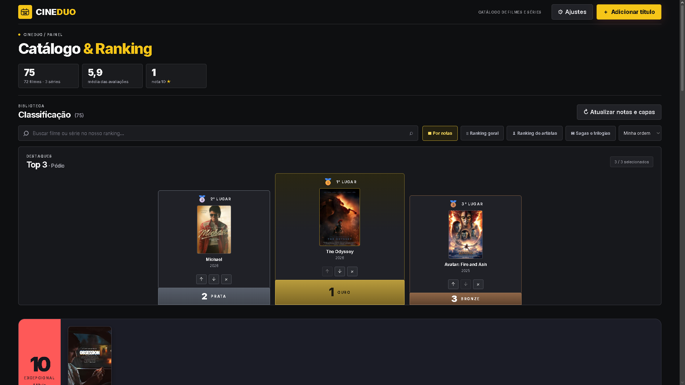
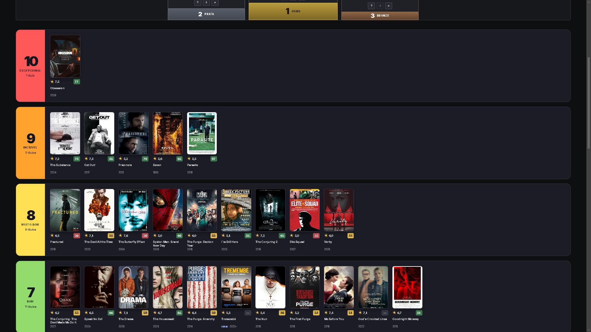
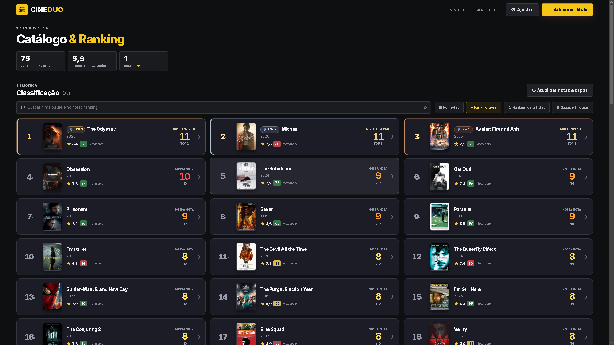
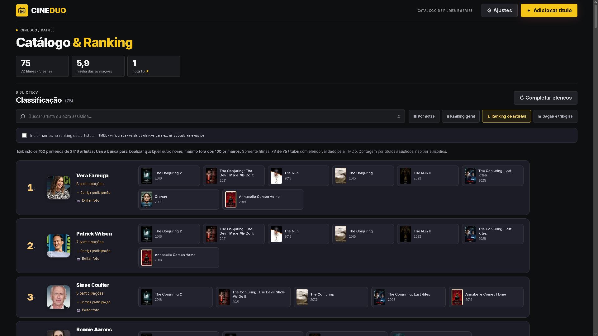
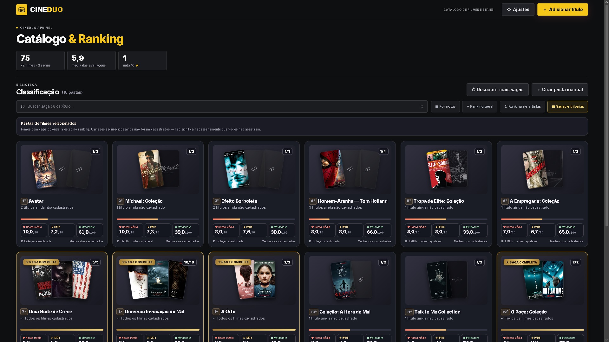

# CineDuo

A local Python application for tracking and ranking movies and TV series.

CineDuo began as a movie list I maintained with my girlfriend in a notepad. I developed it into a personal catalog with custom rankings, metadata lookup, cast statistics, and franchise tracking.

## Features

- **Top 3 podium:** gold, silver, and bronze positions, separate from the 0–10 rating tiers.
- **Two ranking views:** movies grouped by personal score and an overall numbered ranking.
- **Actor ranking:** appearances across cataloged titles, with portraits and search.
- **Franchise collections:** sequels, prequels, missing entries, and automatically calculated rating averages.
- **Movie and series details:** posters, cast, descriptions, trailers, personal ratings, and notes.
- **API integrations:** OMDb for IMDb ratings and Metascore; TMDb for additional movie metadata and collections.

## Screenshots

### Top 3 podium



| Rating categories | Overall ranking |
| :---: | :---: |
|  |  |
| **Actor ranking** | **Franchise collections** |
|  |  |

*Screenshots are from a local catalog. New installations start with an empty library.*

## Technology

- **Backend:** Python (standard library HTTP server)
- **Frontend:** HTML, CSS, and vanilla JavaScript
- **Database:** SQLite
- **External data:** [OMDb](https://www.omdbapi.com/) and [TMDb](https://www.themoviedb.org/)

No additional Python packages are required.

## Installation

Requires Python 3 and a modern web browser.

```bash
git clone https://github.com/alexandrekastro/Cineduo.git
cd Cineduo
```

On **Windows**, run `INICIAR_WINDOWS.bat`. On other systems, run:

```bash
python app.py
```

Open [http://127.0.0.1:8765](http://127.0.0.1:8765) in your browser.

For automatic metadata retrieval, add your own OMDb and TMDb API keys under **Ajustes (Settings)**. The interface is currently in Brazilian Portuguese.

## Privacy and usage

All catalog data and API credentials are stored locally in `app_data/`, which is excluded from Git. Do not commit databases, backups, or API keys.

The optional local-network mode does not provide user authentication. Do not expose it directly to the public internet.

This is a personal, non-commercial portfolio project. Third-party movie artwork and data remain subject to their respective owners' terms. This product uses the TMDb API but is not endorsed or certified by TMDb.
